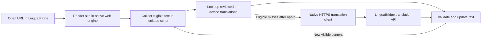

# LinguaBridge architecture audit and mobile browser plan

Reviewed 13 November 2026 at commit `a1daa35`.

## Implementation update

The [Android browser pilot](../../apps/browser-android/README.md) now implements offline French and English phrase translation into Ewondo. The shared renderer leaves unknown phrases and numeric values in the original, and the Android bridge carries settings and status without transferring page text. The APK builds with the native LinguaBridge theme and a bundled demonstration.

The repository now scopes API authorization, verifies cached financial results, keeps generated translations out of PostgreSQL, and restricts signed callback destinations. The [privacy migration](../../infrastructure/migrations/20261113-private-translation-memory.sql) must be applied separately to existing databases. Review and remove any historical request-derived rows according to the deployment's retention requirements.

The Android debug APK passed Gradle assembly, Android lint and signature verification. The bundled DOM translator passed a Chromium smoke test for dynamic content, restoration, hidden text and protected pages. This test uses a simulated native bridge. A physical Android device is still needed to verify the WebView handshake, layout and accessibility.

The implementation verification passed 249 workspace tests and 73 integration tests. API and extension type checks, the desktop extension smoke check, web lint and the web static export also passed. The production dependency audit reported zero known advisories at the time of the run.

### Desktop extension follow-up, 13 November 2026

The content script now covers matching HTTP(S) child frames, observes open Shadow DOM and translated attributes after page updates, and remembers when the user turns on automatic translation so later documents start translating. Protected and editable content stays in source form. The built extension and targeted tests pass. Browser control on the user's open Chrome session stopped before its URL could be verified, so the installed extension was not visually retested in that session.

A static HTML audit of the live English and French Wikipedia Cameroon pages found 1,936 of 2,446 and 1,642 of 2,204 sampled text segments unchanged by the bundled Ewondo lexicon, respectively. These counts include proper names and other text that need not change. They show that DOM coverage alone cannot deliver complete general translation. The local API endpoint was unreachable during this audit. Broader coverage requires an evaluated translation provider and explicit page-text processing rules; it is not claimed by this extension build.

This remains an internal pilot. Remaining work includes real-device and partner-site tests, linguistic and distribution review, broader language coverage, iOS, and online translation. Legacy desktop composite DOM rewriting still needs a migration to the new page translator or equivalent regression coverage. Durable job processing and cross-instance key and quota persistence remain production work.

## Recommendation

Build a standalone LinguaBridge browser that translates eligible pages automatically after the user selects a target language and enables auto-translate. Start with an Android pilot for public French and English pages and one native-speaker-reviewed target. Use Ewondo as the first candidate because the repository has the most developed Ewondo lexicon and benchmark material. Expand language and site coverage according to measured results. Start the iOS platform and entitlement investigation in parallel.

LinguaBridge can already replace some visible text on a desktop page. The missing pieces are reliable document lifecycle handling, truthful translation coverage, safe DOM edits and enforceable rules for processing page text. A mobile shell alone would inherit those problems.

## Architecture as implemented

| Surface | Runtime and data flow |
| --- | --- |
| Desktop extension | Chromium MV3 injects a content script and Shadow DOM UI. A user action triggers a whole-page walk and bundled lexicon translation. A mutation observer then processes newly added or changed content. The service worker has a separate API-first translation path with local fallback and a separate loopback speech path. |
| Public web app | Next.js exports a static landing page, install portal and rule-based banking assistant. The widget and API are separate integrations. GitHub Pages supplies no translation backend. |
| Integrations | The JavaScript SDK calls REST. React wraps it with hooks and components. The widget extracts page segments and calls the batch API. Express, Fastify and Next.js fintech adapters localize selected JSON fields. MoMo, Orange Money and aggregator helpers handle partner-specific payloads. |
| Translation API | Fastify exposes translation, batches, verification, speech, language and admin routes. The pipeline currently runs language detection → cache lookup → first matching provider → financial guard → cache write. Cache hits return early. Defaults are Fixture plus lexicons, LibreTranslate and optionally OpenRouter. |
| Packs and language quality | Checked-in manifests, glossaries and corpora live under `language-packs` and `docs/research`. API manifests, the extension lists, MCP pack loading and CLI discovery are separate sources of capability information. The Ewondo, Fulfulde, Hausa, Kanuri and Cameroon Pidgin dictionaries provide uneven coverage. Duala is experimental. Basaa and Bulu are templates. |
| Speech | The TypeScript orchestrator and AfricanVoiceProvider can call a separate Python Flask/PyTorch service with MMS weights. The extension, SDK React and widget have additional client audio paths and caches. |
| Persistence and operations | Hybrid translation memory uses a process-local Map and optional PostgreSQL. Drizzle schema and Supabase SQL are separate persistence definitions. Fastify key management and audit logs are process-local. Async webhook batches run in the API process. Docker Compose supplies Postgres, Redis and LibreTranslate. GitHub Actions packages the desktop extension and publishes the static site. |
| CLI and MCP | The CLI ships translation, pack, verify, audit and mock-serve commands. MCP offers pack discovery, glossary, translation and financial tools over stdio or HTTP/SSE. The CLI mock server and MCP translation tools use a Fixture-backed pipeline. |

## Findings

**P0** blocks a public service or real-money pilot. **P1** blocks the public auto-translation pilot or affects an existing primary flow. **P2** covers operational debt and release readiness. Severity assumes the affected component is enabled.

| ID | Priority | Finding and corrective work |
| --- | --- | --- |
| A01 | P0 | **Translation memory can return the wrong sentence.** Read and write keys truncate Base64 to 32 characters, roughly the first 24 bytes of the source. The key omits tenant, context, pack version, privacy and provider policy. A hit also skips the guard and drops review metadata. Use a shared versioned key over the full canonical input and effective policy, preserve provenance, invalidate old keys and verify cache hits before use. [Lookup](../../packages/translation-engine/src/stages/cache-lookup.ts#L22) · [Writer](../../packages/translation-engine/src/stages/cache-writer.ts#L27) |
| A02 | P0 | **The API has no effective admin boundary.** Key creation/listing/revocation, pack mutation and audit dashboards lack route authorization. Translation only requires a key when configured, key records and revocations are process-local, and declared permissions and quotas are separate from route enforcement. The request can supply its own tenant field. Enforce role, scope, quota and tenant at the API boundary, derive tenant from verified credentials and move admin routes off the public browser surface. Disable demo credentials in production. [Key routes](../../apps/api/src/routes/keys.ts#L148) · [Pack routes](../../apps/api/src/routes/packs.ts#L179) · [Logs](../../apps/api/src/routes/logs.ts#L79) · [Dashboard](../../apps/api/src/routes/dashboard.ts#L40) · [Translation auth](../../apps/api/src/routes/translate.ts#L57) |
| A03 | P0 | **Remote processing rules are parsed but unenforced.** `no_external` and `maxLatencyMs` reach the pipeline without constraining provider selection. Webhook destinations can come from callers, and financial drift events can contain source text and sensitive values. A default webhook signing secret is built in. Keep mobile traffic off these callback routes. Enforce provider privacy and time budgets centrally. Use registered, verified callback destinations and scoped secrets for partner integrations. [Request schema](../../apps/api/src/routes/translate.ts#L29) · [Provider executor](../../packages/translation-engine/src/stages/provider-executor.ts#L15) · [Drift callback](../../apps/api/src/routes/translate.ts#L187) · [Dispatcher](../../apps/api/src/webhooks/webhook-dispatcher.ts#L13) |
| A04 | P0 | **The financial guard has correctness gaps.** Extraction deduplicates equal values and the comparison sorts them, so it loses occurrence counts and field association. The guard skips comparison when the source has no recognized entities. That permits newly introduced values in this case. Pattern-based amounts also miss or normalize away some distinctions, including negative signs. Use occurrence- and field-aware protected spans with explicit locale rules, and validate both introduced and changed values on every route. Keep critical banking UI in source form during the pilot. [Extractor](../../packages/financial-domain/src/entity-extractor.ts#L114) · [Deduplication](../../packages/financial-domain/src/entity-extractor.ts#L193) · [Comparison](../../packages/financial-domain/src/entity-extractor.ts#L267) · [Guard](../../packages/translation-engine/src/stages/financial-guard-stage.ts#L11) |
| A05 | P0 | **Persistent cache output is mislabeled as certified.** The hybrid cache writes translated output into `source_text` and stamps rows `certified`. The Supabase migration allows public reads of certified memory under that policy, so deployment grants determine whether those rows are exposed. The upsert refreshes text without refreshing expiry or provider, and L1 repopulation assigns a fresh hour irrespective of the remaining L2 TTL. Use separate reviewed memory and private transient cache stores, restrict access and enforce retention. [Cache write](../../apps/api/src/cache/hybrid-cache.ts#L89) · [Supabase policies](../../infrastructure/migrations/supabase-init.sql#L119) |
| A06 | P0 | **Widget selection output is rendered as HTML.** Page-selected text, provider output and error text are interpolated into `innerHTML`. Render them with text nodes and review other page-derived rendering paths before sharing code with mobile. [Widget selection](../../packages/widget/src/widget.ts#L712) |
| A07 | P1 | **Three translation paths disagree on successful output.** The extension whole-page path takes only the local translated string. The background worker can replace an unchanged or reverted API result with a local result. The widget applies batch output without checking the result status. The local lexicon can mark a partial match or protected-entity-only match as success. Define explicit per-segment results for translated, partial, unsupported and unsafe content. Preserve the original for any segment ineligible for application. [Desktop DOM](../../apps/extension/src/content.ts#L481) · [Background worker](../../apps/extension/src/background.ts#L39) · [Widget batch](../../packages/widget/src/widget.ts#L633) · [Local provider](../../packages/translation-engine/src/providers/sovereign-lexicon.ts#L1556) |
| A08 | P1 | **Source-language detection and routing are insufficient for arbitrary pages.** API `auto` always becomes French. The extension's fallback regex matches literal backslash sequences in place of word boundaries. The API takes the first supporting provider and stops on a miss or error. The NLLB-named provider is a phrase cache and the Python inference experiment is outside the live route. Validate source/target pairs at the API boundary and use calibrated detection with a manual override. Route through eligible providers with explicit quality and privacy checks. [API detector](../../packages/translation-engine/src/stages/language-detector.ts#L7) · [Extension detector](../../apps/extension/src/content.ts#L534) · [API defaults](../../apps/api/src/app.ts#L541) · [NLLB provider](../../packages/translation-engine/src/providers/nllb-local.provider.ts#L180) |
| A09 | P1 | **Translation can interfere with application state.** Desktop composite rewriting removes/reparents children and restores snapshots. Text-node mutations can reapply a stale original, and the observer misses attribute-only changes and mutations within separate shadow roots. Full-page mode scans broadly, including DOM text beyond the viewport, and the traversal lacks consistent exclusion for editable and hidden content. The attribute path can change input-button values, which can have form semantics. Apply verified changes to eligible text nodes and an explicit set of label attributes, preserve elements and compare current values before writing or restoring. [Observer](../../apps/extension/src/content.ts#L1048) · [Attribute handling](../../apps/extension/src/content.ts#L1134) · [Composite writes](../../apps/extension/src/content.ts#L1388) · [Text snapshots](../../apps/extension/src/content.ts#L1555) |
| A10 | P1 | **Desktop auto-translation is confined to a manually translated document.** The saved settings are language and audio. The observer exits until full-page translation has been started, and a fresh navigation creates a new instance. Persist an auto-translate policy and bind each job to a tab and document generation. [Settings](../../apps/extension/src/content.ts#L578) · [Observer](../../apps/extension/src/content.ts#L1052) · [Initial translation](../../apps/extension/src/content.ts#L1583) |
| A11 | P1 | **Capability reporting is fragmented and overly optimistic.** API startup loads embedded manifests, provider routing does not consult the registry and the extension has hardcoded fallback languages and speech availability. A pack disabled in the API registry can still be supported by its provider. Use a versioned capabilities manifest derived from validated pair coverage, pack lifecycle and voice readiness. Model and corpus provenance require explicit review before release. [API registry](../../apps/api/src/app.ts#L541) · [Extension list](../../apps/extension/src/background.ts#L139) · [Duala manifest](../../language-packs/duala/manifest.json) · [License audit](../research/license-audit.md) |
| A12 | P1 | **Speech contradicts the documented degrade-first policy.** The Python service maps Kanuri to Hausa weights and sometimes returns silent WAV data. The extension accepts an audio payload without checking voice identity or whether it contains playable samples. It also prefetches page-derived text and logs excerpts. Validate exact voice, playable audio and consent, keep request text out of URLs and logs, and leave speech out of the first pilot. [Python voice mapping](../../scripts/serve_african_voice.py#L37) · [Silent response](../../scripts/serve_african_voice.py#L354) · [Extension speech](../../apps/extension/src/background.ts#L163) · [Prefetch](../../apps/extension/src/content.ts#L1601) |
| A13 | P1 | **SDKs can reuse stale or insufficiently checked results.** The JS SDK keys its memory by pair and text without domain, context or strict mode. Cache hits return before strict verification. React has no stale-response guard when text or language changes rapidly. Include result-affecting inputs in cache identity, rerun strict checks and cancel or discard superseded requests. [JS SDK](../../packages/sdk-js/src/client.ts#L219) · [React hook](../../packages/sdk-react/src/hooks.ts#L43) |
| A14 | P1 | **Current hosting cannot support a public mobile client.** The Pages workflow builds with loopback API settings and the extension also defaults to loopback. On phones those addresses target the device. Deploy a dedicated HTTPS translation service before enabling remote page translation. Keep the static showcase separate from it. [Pages workflow](../../../.github/workflows/deploy-pages.yml) · [Widget config](../../apps/web/src/components/WidgetMount.tsx#L20) · [Extension config](../../apps/extension/src/background.ts#L5) |
| A15 | P2 | **Batch capacity and reliability are limited.** The REST schema caps a batch at 50 items, while the widget submits its entire collection together. The pipeline launches all work concurrently and async webhooks run via `setImmediate`. The async route counts unverified items as successes. Chunk by item count and UTF-8 bytes, bound concurrency and use a durable queue for integrations that require asynchronous delivery. Bound cache sizes and add active expiry. [Batch schema](../../apps/api/src/schemas/openapi-schemas.ts#L233) · [Widget](../../packages/widget/src/widget.ts#L620) · [Pipeline](../../packages/translation-engine/src/pipeline.ts#L32) · [Async route](../../apps/api/src/routes/translate.ts#L248) |
| A16 | P2 | **Integration correctness differs from REST.** MCP can label an unchanged unsuccessful result completed based on financial fingerprint parity. Fintech middleware accepts a target but its local transformation is Ewondo-only. The Orange Money signature helper also accepts a parsed object and reserializes it, which can fail verification when the partner signs exact wire bytes. Use explicit unsupported statuses and partner-tested raw-body verification. Keep CLI mock and unauthenticated MCP SSE confined to development until separately hardened. [MCP result](../../packages/mcp-server/src/tools.ts#L215) · [Fintech middleware](../../packages/fintech-adapters/src/middleware/fastify.ts#L71) · [Signature helper](../../packages/fintech-adapters/src/orange-money/signature.ts#L10) · [CLI mock](../../packages/cli/src/server.ts#L93) · [MCP SSE](../../packages/mcp-server/src/transports/sse.ts#L29) |
| A17 | P2 | **Release checks miss important entry points.** The workspace glob excludes the separate E2E suite. Desktop build CI verifies artifact structure only. Extension bundles are web-accessible on all origins and host permissions are broader than needed. The architecture overview describes guarantees that differ from the runtime routes. The README references a repository license file that is absent from this commit. Put integration, built-artifact and actual browser tests in CI, align the architecture docs with the implementation and clarify code and asset licensing for distribution. [Workspace](../../pnpm-workspace.yaml) · [Extension CI](../../../.github/workflows/build-edge-extension.yml) · [Manifest](../../apps/extension/manifest.json) · [Architecture overview](overview.md) · [README](../../README.md) |
| A18 | P1 | **The dependency baseline includes high and critical advisories.** The full lockfile audit reported 71 advisories. The production dependency graph reported 55, including 19 high and 7 critical. Next.js 14.2.15 is in the vendor's affected range for a server middleware advisory. Its practical impact depends on using the affected feature, while the Pages build exports static files. Triage advisory reachability per deployment, upgrade supported versions and add dependency auditing to CI. [Web dependency](../../apps/web/package.json#L13) · [Next.js vendor advisory](https://github.com/vercel/next.js/security/advisories/GHSA-f82v-jwr5-mffw) |
| A19 | P2 | **Transpilation hides type and lint failures.** The API and extension use bundling scripts that can emit artifacts despite failing their own strict TypeScript checks. Their NodeNext configs conflict with extensionless ESM imports, and the API also has failing test-fixture and implementation types. The web lint task prompts for a missing ESLint configuration and exits in CI mode. Align module resolution with how each artifact is consumed and add type and noninteractive lint checks. [TypeScript defaults](../../tsconfig.base.json) · [API build](../../apps/api/package.json#L7) · [Extension build](../../apps/extension/package.json#L6) · [Web lint](../../apps/web/package.json#L6) |

## Mobile platform choice

Some mobile browsers support extensions. Safari on iPhone and Firefox for Android have their own installation and compatibility paths. Google documents adding Chrome extensions from a phone to desktop. Shipping a standalone app gives LinguaBridge control of the translation experience across platforms. [Safari extensions](https://support.apple.com/en-euro/guide/iphone/iphab0432bf6/ios) · [Firefox for Android extensions](https://support.mozilla.org/en-US/kb/find-and-install-add-ons-firefox-android) · [Chrome extension installation](https://support.google.com/chrome/answer/2664769)

| Platform | Implementation decision |
| --- | --- |
| Android | Kotlin shell using the system WebView. Prototype AndroidX WebKit isolated-world injection and messaging on the lowest supported device. Feature-detect support. On older engines offer normal browsing and a clear translation-unavailable state. If device coverage is inadequate, evaluate GeckoView, which can ship a built-in WebExtension inside the APK. [AndroidX WebKit](https://developer.android.com/reference/androidx/webkit/WebViewCompat) · [GeckoView bundled extensions](https://mozilla.github.io/geckoview/consumer/docs/web-extensions) |
| iOS | Swift shell with `WKWebView`, `WKNavigationDelegate`, a main-frame user script in a dedicated `WKContentWorld` and native-to-script calls using typed arguments. Prototype on actual iPhones, check App-Bound Domains behavior and start the managed entitlement process early if targeting default-browser support. Apple lists full script access across domains as a capability of its default-browser entitlement. Check App Review guidance for the intended rollout. [WKWebView](https://developer.apple.com/documentation/webkit/wkwebview) · [WKContentWorld](https://developer.apple.com/documentation/webkit/wkcontentworld) · [App-Bound Domains](https://webkit.org/blog/10882/app-bound-domains/) · [Default browser](https://developer.apple.com/documentation/Xcode/preparing-your-app-to-be-the-default-browser) · [App Review](https://developer.apple.com/app-store/review/guidelines/) |
| Shared | Extract a TypeScript page translator into a workspace package and bundle it into both apps and the desktop extension. Keep navigation, secure preferences, data controls and any remote transport in native code. Use an existing rendering engine and keep websites on their original origins with normal links and sessions. |

## How pages will translate automatically

1. **Set preferences once.** The native address bar opens URLs or search results. The user picks a target language, enables automatic translation and can pause it globally or for the current site. A toolbar status shows translating, translated, partial, original or unavailable.
2. **Start on committed navigation.** Give each top-level document a generation and cancel the old job on navigation, reload, route change, target change or tab close. Inject the app-bundled translator in an isolated main-frame context. Check the committed origin and the live generation before accepting messages. Handle SPA history changes, back/forward and late rendering.
3. **Read eligible visible segments.** Use document and element language tags, then on-device sample detection for French or English. Let users correct a guess. Collect visible text and approved accessibility labels, starting in the viewport. Exclude hidden or editable elements, form values, password and OTP flows, cross-origin frames, downloads and PDF content. Treat DOM content as untrusted even in an isolated world. [WebKit content worlds](https://developer.apple.com/documentation/webkit/wkcontentworld) · [Same-origin policy](https://developer.mozilla.org/en-US/docs/Web/Security/Defenses/Same-origin_policy)
4. **Translate on-device first.** Use a bundled, versioned pack for reviewed phrases and terminology. When the user enables online translation, native code may send only eligible public-page segments with opaque IDs, language pair and pack version to a fixed HTTPS endpoint. Keep site URL, cookies, form data and sensitive values out of translation requests and telemetry. Keep login, checkout and account screens outside the automatic pilot. Use scoped, short-lived credentials if the backend requires them. Give the isolated script only a bounded segment channel and keep native browsing permissions and secrets out of it. [Android bridge security](https://developer.android.com/privacy-and-security/risks/insecure-webview-native-bridges) · [Google Play disclosure and consent](https://support.google.com/googleplay/android-developer/answer/11150561)
5. **Validate and apply.** Results carry segment ID, status and provider provenance. Accept only current results whose DOM source still matches. Protect currency, amounts, identifiers and other immutable spans across providers. Apply strings as text or via the approved attribute list, preserve event handlers and element identity, and keep an immediate Show original action. Preserve original text for every failed or unsafe segment and display partial coverage where appropriate.
6. **Keep up as the page changes.** Observe relevant mutations and queue only new or modified visible segments. Discard the translator's own writes, debounce updates, cap batch size and concurrency, cancel work for backgrounded or closed tabs and guard against late results. Use bounded per-document caches. On timeout, offline miss or renderer crash, leave the page readable in its original form.

The first beta covers eligible HTML pages opened inside LinguaBridge, including ordinary sites where French or English source text can be identified. Start the pilot on a published list of verified sites, including public bank help and fee pages. Authenticated banking and payment flows need partner validation in a sandbox before any expansion. The first release excludes other apps, cross-origin frames, PDFs and image text. A single-page website cannot reliably provide the same access to third-party page content through iframes. [Same-origin policy](https://developer.mozilla.org/en-US/docs/Web/Security/Defenses/Same-origin_policy) · [Frame restrictions](https://developer.mozilla.org/en-US/docs/Web/HTTP/Reference/Headers/X-Frame-Options)

### Shared interfaces

| Boundary | Proposed contract |
| --- | --- |
| Browser shell → page translator | Start or stop a document session with its generation, source override, target, pack version and translation policy. Use one session per live top-level document. |
| Page translator → local pack | Resolve a batch of opaque segment IDs and source strings to per-item status, translated text and reviewed-pack provenance. Identify fallback and partial coverage explicitly. |
| Browser shell → online service | Send bounded batches of eligible segments to a dedicated synchronous endpoint. Begin with reviewed public site routes for cloud processing. Verify the committed origin and route locally, and keep the rule set in the app. Require local-only treatment when the page's eligibility is uncertain. |
| Results → renderer | Track the source and last applied value for each live node. Apply only to the same generation and expected node value. Restore only if the node still contains the translator's last write. |

The native toolbar should show the committed origin and use the engine's normal HTTPS and certificate handling. Delegate recognized external app links through the OS and handle permissions and downloads from native UI. Keep browser tabs and navigation usable even when translation is disabled or unsupported. Use isolated, nonpersistent storage if private browsing is added after the pilot.

## Implementation order and release gates

| Milestone | Deliverable and exit criteria |
| --- | --- |
| 0. Fix shared correctness | Close A01–A06 for the deployment surface. Add a unified language/quality contract and fixtures for repeated values, field association, introduced values, false-success output, cache policy and tenant isolation. Wire integration tests into CI. No browser page text goes to a public API until this gate passes. |
| 1. Prove Android on-device translation | Address bar, back/forward, reload, target picker, per-site pause and Show original. Implement the shared page translator and use it on public HTML and synthetic SPA fixtures. Prove isolation, SPA changes, restoration, low-memory behavior and normal link/form behavior on physical Android phones. Run the iOS platform spike in parallel. |
| 2. Prove language quality | Start with French/English → Ewondo if native-speaker review supports it. Evaluate unseen public pages and report both coverage and accuracy per pair. Include short labels, full sentences, mixed language, accessibility labels, financial terminology, sign, currency, negation and fees. Require zero observed protected-value or action-semantic errors on the pilot acceptance corpus. Add Fulfulde, Hausa, Kanuri and Cameroon Pidgin individually as their evidence supports them. |
| 3. Add optional online coverage | Ship a dedicated bounded batch route with enforced privacy, safe result statuses, cancellation, rate limits and metadata-only telemetry. Test with a poor connection, long page and API outage. Verify through network inspection that the disabled and offline modes produce no translation traffic. Set a starting performance target of p95 ≤ 1 second to first eligible on-device translation after document readiness on an agreed low-end Android device. Measure remote mode separately. |
| 4. Release beta and expand | Run Android internal distribution and iOS TestFlight after the WebKit and entitlement checks. Test TalkBack and VoiceOver, redirects, history, tab isolation, site opt-outs, certificate failures, recovery and ordinary web compatibility. Publish support boundaries and privacy disclosures. Run a separate partner-sandbox review before supporting authenticated workflows. |

The checked-in NLLB inference script points to Meta's distilled 600M research checkpoint. Its model card uses a noncommercial license and describes research use. A general web translation provider needs documented per-pair evaluation, a compatible deployment license and an explicit decision on whether page text leaves the device. [Meta model card](https://huggingface.co/facebook/nllb-200-distilled-600M)

## Verification

The audit covers repository code and local checks. Production configuration, live partner banking sites, native-speaker accuracy, model quality and physical mobile browser behavior require separate evidence.

| Check | Observed result |
| --- | --- |
| Frozen install | Passed on Windows with Node 24.20.0 and pnpm 11.25.0. CI specifies Node 20 and pnpm 9. |
| Workspace build | All 15 package builds passed, including the Next.js static export and the unpacked desktop extension. |
| Integration suite | 73 passed across 20 files when invoked explicitly from the workspace. |
| Built API startup | Started the compiled Fastify artifact locally and received HTTP 200 from the language catalog. |
| Workspace tests | 236 passed and one failed across the initial run and a targeted follow-up. The API test for preserving FCFA amounts across five languages exceeded its five-second timeout in both multi-suite runs. It passed individually with one worker. The extension, web and MCP test packages passed on the follow-up. |
| Duala import and vocabulary scripts | 4 passed. |
| Built desktop extension smoke check | Manifest, script injection, text translation, common label attributes and the FCFA sample passed in Happy DOM. The hover-to-speech assertion failed in a harness that leaves audio disabled and stubs the audio request. Real-browser speech remains unverified. |
| Type checking | API and extension each exited with code 2. Both have NodeNext relative import errors. The API also reported missing or incompatible types. |
| Lint | Exited with code 1 at Next.js ESLint setup. |
| Dependency audit | 71 advisories across all dependencies, 55 in the production dependency graph. Applicability depends on enabled runtime features. |
